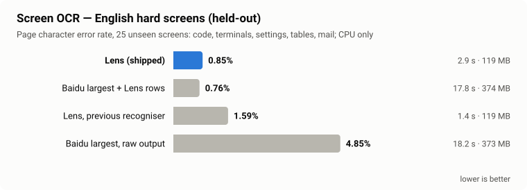
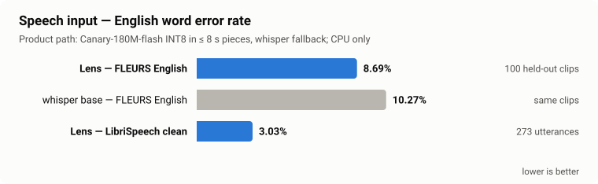
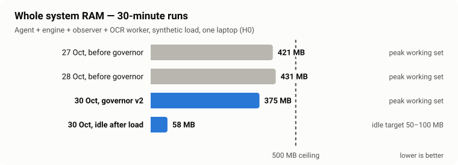
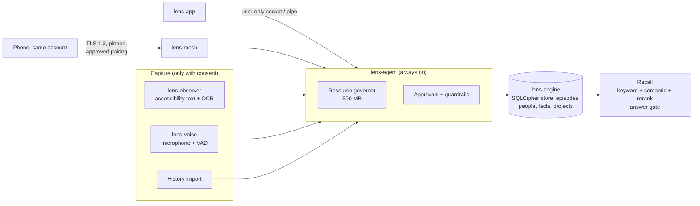

# Lens

**Private memory for everything you see and hear — on your own devices, on CPU, inside 500 MB of RAM.**

Lens is the local-first perception and long-term memory subsystem of Second Brain AI's Recursion application.
It reads only what you allow (screen text, speech, imported history), keeps every original record encrypted on
the device, organises it into episodes, people, facts and projects, and answers questions in plain language with the
original evidence — or says it found nothing. No cloud, no GPU, no data leaves your account.

> **Status:** Lens V1 is in development and **not release-ready**. Every number below comes from a recorded run
> ([docs/VERIFICATION.md](docs/VERIFICATION.md)); open gates are listed in
> [docs/RELEASE_READINESS.md](docs/RELEASE_READINESS.md). Nothing planned is presented as working.

## Highlights

- **Reads the screen like a person would.** Accessibility text first (Windows UI Automation, Linux AT-SPI, macOS
  Accessibility, Android accessibility service), OCR of only the changed region as the fallback. Password fields,
  password managers, private-browsing windows and lock screens are never read.
- **English OCR on par with Baidu's largest models** at a third of the memory: 0.85% page error on unseen hard screens
  (code, terminals, settings, tables), 119 MB, CPU only.
- **Speech in and out, offline.** English speech input better than whisper base on the same clips; spoken replies with
  a mixed-precision Kokoro and a trained Lens pronunciation model.
- **Fits a 500 MB budget for the whole system.** A resource governor never lets two heavy models share RAM.
- **Encrypted by default.** SQLCipher database with the key held by the operating system (DPAPI, Keychain, Secret
  Service, Android Keystore). Backups, restore, key rotation and deletion with provenance.
- **Your devices, your account only.** Devices of different accounts never pair; a new device needs your approval with a
  matching code; Lens never acts, changes settings or sends a message on its own.

## Benchmarks

All measured on CPU on one development laptop (ROG Zephyrus G14, "H0"); low-end laptops are not yet verified.
Charts are generated from the report files by [`scripts/make_readme_charts.py`](scripts/make_readme_charts.py).

<picture>
  <source media="(prefers-color-scheme: dark)" srcset="docs/images/ocr-heldout-dark.svg">
  
</picture>

The shipped configuration was chosen on the development screens only, then run once on the held-out screens.
"Lens rows" is Lens's own line assembly for tables, forms and code; Baidu's raw output splits those rows apart.

<picture>
  <source media="(prefers-color-scheme: dark)" srcset="docs/images/asr-english-dark.svg">
  
</picture>

Long audio is decoded in pieces of at most 8 seconds, which keeps the speech worker under 400 MB; a segment the model
garbles falls back to whisper.

<picture>
  <source media="(prefers-color-scheme: dark)" srcset="docs/images/ram-whole-system-dark.svg">
  
</picture>

Synthetic load (invisible test windows, a question every 30 s). The last real-screen run (27 Oct) failed at 905 MB;
its fixes are verified on synthetic windows only and a second real-screen run is pending.

| Recall (614 development and test questions, 10k memories; not the sealed holdout) | Result | Target |
|---|---:|---:|
| Correct memory ranked first (answerable questions) | 0.836 | 0.80 |
| Correct memory in the top 3 | 0.927 | — |
| Answered correctly while answering ≤ 5% of unanswerable questions | 0.49 | 0.80 — **not met** |

## Platforms

One C++20 core everywhere; each OS keeps its own native window, accessibility and key-storage layer.

| | Windows | Linux | macOS | Android | iOS |
|---|:---:|:---:|:---:|:---:|:---:|
| Encrypted memory core | ✅ tested | ✅ tested | ✅ CI smoke test | ✅ emulator | 🟡 builds |
| Background agent | ✅ tested | ✅ tested | ✅ CI smoke test | 🟡 builds | — |
| Screen observation | ✅ tested | ✅ tested (virtual display) | 🟡 builds | 🟡 builds | — |
| Screen OCR | ✅ tested | ✅ tested | 🟡 builds | 🟡 builds | — |
| Speech in / spoken replies | ✅ tested | ✅ tested | 🟡 builds | 🟡 builds | — |
| App | ✅ WebView2 | ✅ GTK + WebKitGTK | ✅ WKWebView (CI self-test) | ✅ emulator: own memory + laptop link | ⬜ not built |

✅ = automated tests pass on that OS (CI = GitHub's runners, no models there; emulator = Android 15 emulator, no phone
yet) · 🟡 = compiles and links, not yet run on real hardware · ⬜ = not built. Linux builds and tests run in a container,
Android with the NDK on Windows and on the emulator, macOS and iOS in [GitHub Actions](.github/workflows/portable.yml).
On Android the phone keeps its own encrypted memory and works without a laptop; recall there is keyword-only for now.

## How it works



## Components

| Component | Role |
|---|---|
| `lens-agent` | Always-on owner process: engine, consented capture, governor, device link, approvals |
| `lens-engine` | Encrypted store (SQLCipher), indexing, retrieval, speech recognition, lifecycle operations |
| `lens-observer` | Consent-gated observation: accessibility text first, OCR fallback (Windows, Linux, macOS) |
| `lens-ocr` | Screen text detection and script-routed recognition (PaddleOCR models, ONNX Runtime) |
| `lens-voice` | Consent-gated microphone capture with voice-activity detection and language routing |
| `lens-sherpa`, `lens-tts` | Speech recognition routes (Canary, Dolphin, IndicConformer) and spoken replies (Kokoro) |
| `lens-app` | App window: WebView2 (Windows), WebKitGTK (Linux), WKWebView (macOS) |
| `lens-mesh` | Authenticated, encrypted link to paired devices of the same account |
| `android/` | Android and Wear OS companions (Kotlin, Jetpack Compose) |
| `lens_model/` | Training, export and evaluation of the Lens model (development only) |

The core is C++20. Python is used only for development, benchmarks, training and tests; it is never a runtime
dependency of the product.

## Privacy and guardrails

- Capture requires explicit, source-specific consent and can be paused at any time.
- Devices of different Lens accounts never pair or exchange data; pairing needs your approval on a trusted device.
- No involuntary actions: requests from devices or models stay pending until you approve them in the app, and expire.
- Personal content never enters version control, model weights, telemetry or logs. There is no cloud inference.
- Deletion removes derived records together with their sources.

## Building

Prerequisites: Windows 11 x64, Visual Studio with MSVC C++ tools and CMake, Git, Python 3.12 with uv,
and the project-local PowerShell 7.6.6. Dependencies are restored from the committed lock files:

```powershell
.venv\Scripts\python.exe scripts/bootstrap_pwsh.py
pwsh -NoProfile -File scripts/bootstrap-upstreams.ps1
uv venv --python 3.12 .venv
uv pip install --python .venv\Scripts\python.exe -r requirements-dev.lock.txt
.venv\Scripts\python.exe scripts/restore-artifacts.py
pwsh -NoProfile -File scripts/build-native.ps1 -Dependencies
uv venv --python 3.12 .tools/ocr-convert
uv pip install --python .tools/ocr-convert/Scripts/python.exe -r requirements-ocr-export.lock.txt
.venv\Scripts\python.exe scripts/prepare_native_ocr.py
.venv\Scripts\python.exe scripts/prepare_sherpa_reference.py
pwsh -NoProfile -File scripts/build-native.ps1
```

OCR model export runs in the isolated `.tools/ocr-convert` environment because Paddle2ONNX 2.1.0 does not load
with the development environment's Paddle. Re-exports are compared against the lock files; drift is never
accepted silently.

Other operating systems (see [docs/HANDOFF.md](docs/HANDOFF.md)):

```powershell
docker build -t lens-linux ci/linux
docker run --rm -v "${PWD}:/src" lens-linux bash ci/linux/build.sh   # build + smoke test
powershell ci\android\build.ps1                                         # Android arm64-v8a (NDK r27.1); -Abi x86_64 for the emulator
```

## Testing

```powershell
.venv\Scripts\python.exe -B -m unittest discover -s tests -v
```

270 tests pass on Windows; the Android end-to-end test (`tests/test_android_link.py`) runs when an emulator or device is
connected and is skipped otherwise. Tests use temporary directories and invisible test windows only; they never read
the real screen or open the microphone. The Android app builds with `android\gradlew.bat` (JDK 17) after
`ci\android\build.ps1` has staged its native library.

## Packaging

```powershell
.venv\Scripts\python.exe -B scripts/package_lens.py
powershell -NoProfile -File scripts/install_lens.ps1
powershell -NoProfile -File scripts/uninstall_lens.ps1
```

The installer is per-user and requires no administrator rights. Screen and microphone capture remain off until
the user enables them in the application. Uninstalling keeps the encrypted memories unless removal is requested.
Release artifacts are not yet code-signed.

## Benchmark scripts

| Area | Script |
|---|---|
| Retrieval | `scripts/benchmark_retrieval_nl.py` (tuning on the dev split only), `scripts/verify_retrieval_report.py` |
| Screen OCR | `scripts/benchmark_ocr_native.py`, `ci/ocr_parity.py` (any OS), `scripts/benchmark_ocr_memory.py` |
| Speech | `scripts/benchmark_asr_english.py`, `scripts/benchmark_voice.py` |
| Observation language ID | `scripts/benchmark_observer_lid.py` |
| Storage and import | `scripts/benchmark_storage.py`, `scripts/benchmark_history_import.py` |
| Resources | `scripts/sustained_run.py`, `scripts/profile_combined.py` |
| Hardware compatibility | `scripts/hardware_profile.py`, `scripts/check_hardware_compat.py` |

Sealed holdout sets are never used for tuning. Every run, including failed runs, is retained under `reports/`.

## Documentation

| Document | Content |
|---|---|
| [docs/LENS_V1_SPEC.md](docs/LENS_V1_SPEC.md) | Canonical product specification |
| [IMPLEMENTATION_STATUS.md](IMPLEMENTATION_STATUS.md) | What exists today |
| [docs/VERIFICATION.md](docs/VERIFICATION.md) | Every measurement with its evidence |
| [docs/RELEASE_READINESS.md](docs/RELEASE_READINESS.md) | Release gates and blockers |
| [docs/REQUIREMENTS.md](docs/REQUIREMENTS.md) | Detailed requirements register (machine-readable: [docs/requirements.json](docs/requirements.json)) |
| [docs/acceptance-gates.md](docs/acceptance-gates.md) | Acceptance gates and hardware tiers |
| [ARCHITECTURE.md](ARCHITECTURE.md) | Architecture as built |
| [docs/retrieval.md](docs/retrieval.md) | Retrieval design and decisions |
| [docs/history-import.md](docs/history-import.md) | Historical data import |
| [docs/LENS_MODEL.md](docs/LENS_MODEL.md) | Trained Lens model: architecture and training plan |
| [docs/datasets.md](docs/datasets.md) | Dataset provenance and licences |
| [docs/HANDOFF.md](docs/HANDOFF.md) | Engineering handoff: how to build, test and continue |
| [AGENTS.md](AGENTS.md) | Mandatory engineering rules |
| [LICENSES.md](LICENSES.md) | Third-party licences |

## Licence

No licence has been granted for the Lens-specific source code; all rights are reserved by Second Brain AI.
Third-party components remain under their own licences ([LICENSES.md](LICENSES.md), `third_party/licenses/`).
